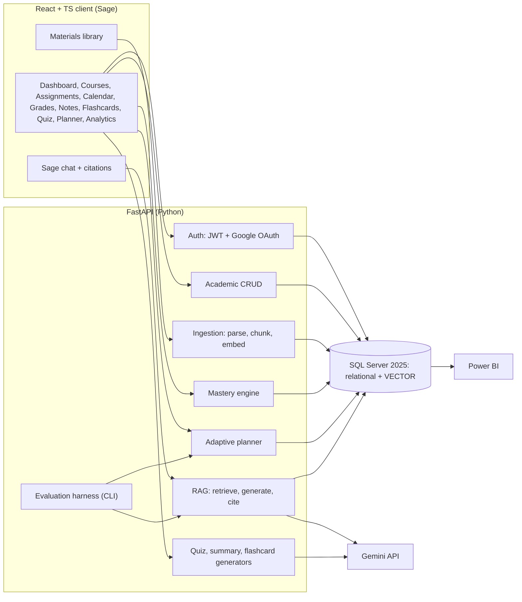
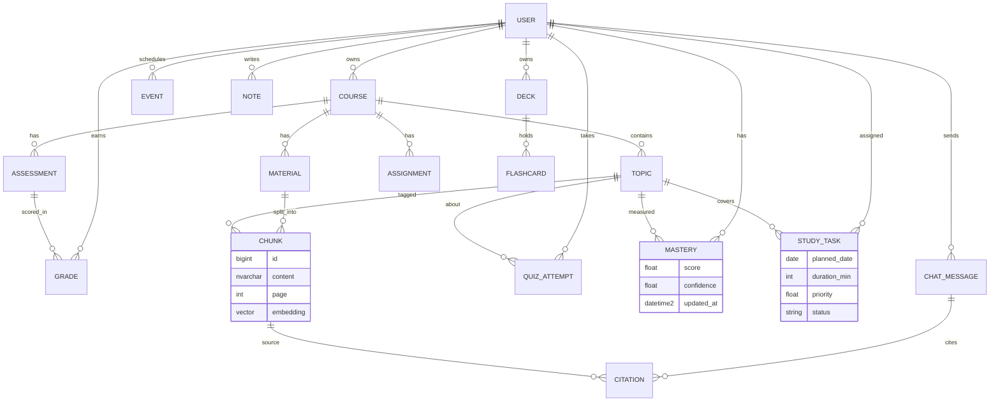
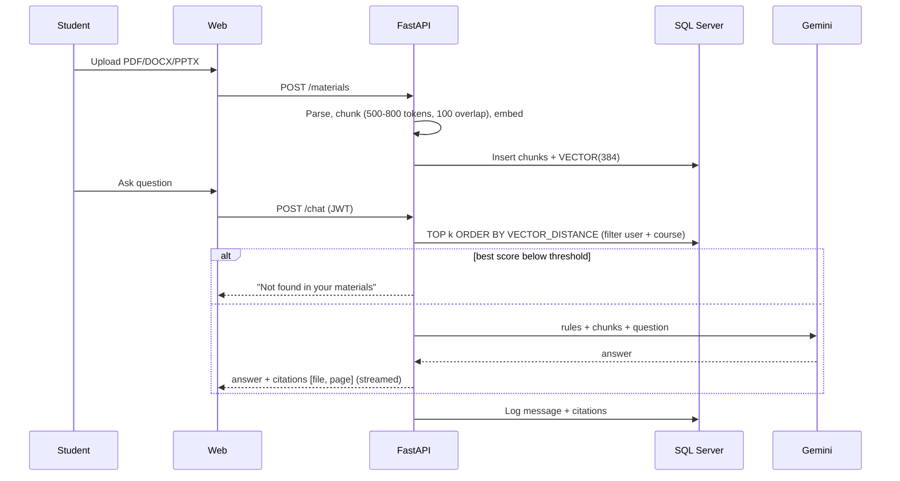

# Sage: AI Academic Assistant, Master Plan v2 (30 weeks)

Replaces `shiori_based_master_plan.md`. Audit evidence for every change is in [plan_review.md](file:///C:/Users/mstfy/.gemini/antigravity-cli/brain/f34838b2-b1f6-4bad-9500-6c845ca76728/plan_review.md).

## Goal
Build **Sage**, a web-based AI study assistant, as a clean rebuild. Shiori-v1 was studied as a **feature and UX reference only**. No Shiori code goes into the repo. The project's original contribution is the whole system, and especially:
- **RAG over the student's own course files** with page-level citations and refusal when the answer isn't there
- **Mastery model** per topic (quizzes + grades + time decay)
- **Adaptive study planner** that re-plans on new grades, quiz results, deadline changes and missed tasks
- **Evaluation** (retrieval, answer faithfulness, planner vs. LLM baseline) and **Power BI** analytics on SQL Server

> [!IMPORTANT]
> Cite Shiori in thesis chapter 2 (related work) and tell the supervisor it was the UX reference. Never copy its files, components or styles verbatim. Write code from your own designs.

## Confirmed decisions
| Topic | Decision |
|---|---|
| Name | **Sage** (product and assistant persona) |
| Approach | Clean rebuild. Shiori = reference only |
| Duration | 30 weeks, mid-Oct 2026 → mid-May 2027 (confirm exact deadline) |
| Team | 10 members, 4 squads + PM |
| LLM | Gemini 2.5 Flash via server-side key (`google-genai` SDK). No training of our own LLM |
| Embeddings | `BAAI/bge-small-en-v1.5` (384-d, local, free). Benchmarked against 1-2 alternatives in B-03 |
| Database | **SQL Server 2025** in Docker (dev port 1434), native `VECTOR(384)` + `VECTOR_DISTANCE` |
| Backend | Python 3.11+, FastAPI, SQLAlchemy 2, Alembic, pyodbc + ODBC Driver 18 |
| Frontend | React + TypeScript + Vite + Tailwind CSS, React Router, TanStack Query, Recharts |
| BI | Power BI Desktop on read-only SQL views |
| Dropped | Pro/Stripe, browser extension, MCP server, in-browser LLM, 3D landing page |
| Language | English UI and English embedding model |

## Feature scope
| Tier | Features |
|---|---|
| **MVP (must ship)** | Auth (email + Google), courses, assignments/deadlines, calendar, grades + GPA, notes, materials upload library, **Sage chat with citations**, summaries, generated quizzes, flashcards with spaced repetition, mastery + weak topics, **adaptive planner**, analytics page, Power BI dashboards |
| **Should** | Focus/Pomodoro timer, XP + streaks, notifications, syllabus import (uses the RAG parser) |
| **Stretch** | Google Classroom sync, habits, friend leaderboard, PWA/offline, OCR for scanned PDFs, Bayesian Knowledge Tracing, small fine-tuned model |

## 1. Architecture



**Design rules**
- FastAPI is the single system of record. The client caches with TanStack Query and has no business logic in `localStorage`.
- Every query filters by `user_id` from the JWT. SQL Server Row-Level Security is the second layer.
- The Gemini key lives only on the server, and all AI calls go through one `llm` service (caching, retries, rate limits).
- A `VectorStore` interface wraps SQL Server `VECTOR`, so ChromaDB can be swapped in if the 2025 vector features disappoint (decision gate wk 4).
- Contract-first: OpenAPI is the source of truth, and the TS client types are generated from it (`openapi-typescript`).

## 2. Data model (core)



Grades and semesters are first-class tables from day one. Shiori kept them only in the browser, which made them unusable for mastery or BI.

## 3. Core designs

### 3.1 RAG


### 3.2 Mastery and planner
- `mastery = decay-weighted mean of quiz and grade scores (0..1)`
- `priority = w1*deadline_urgency + w2*assessment_weight + w3*(1 - mastery)`
- Scheduler: greedy fill of the student's daily available hours by priority, re-run on trigger events. Every task stores a "why" string.
- **Baseline:** an LLM-generated plan from the same inputs (what Shiori ships). The thesis claim is that the rule-based adaptive planner beats it on deadline coverage, weak-topic coverage and load balance.
- Stretch: BKT mastery compared against the weighted mean.

### 3.3 Task lifecycle
`Pending → InProgress → Done`, `Pending → Missed → Rescheduled → Pending` (planner re-runs on Missed).

## 4. Roadmap (30 weeks)

| Phase | Weeks | Focus | Gate |
|---|---|---|---|
| 1 Foundation | 1-4 | Requirements, SRS, SDD, ERD, API contract, design system + wireframes, env, CI | **G1 (wk 4)** |
| 2 Core app | 5-10 | Auth, academic CRUD, app shell + core pages, ingestion prototype, seeder | **G2 Core app (wk 10)** |
| 3 RAG | 11-15 | Retrieval, cited chat, refusal, summaries, materials UI, eval set v1 | **G3 RAG (wk 15)** |
| 4 Learning loop | 16-19 | Topics, quizzes, flashcards, mastery, weak topics | **G4 (wk 19)** |
| 5 Adaptivity + BI | 20-24 | Adaptive planner, replanning events, Power BI, answer eval | **G5 Feature freeze (wk 24)** |
| 6 Finish | 25-30 | Hardening, security, deployment, user study, final eval, thesis, demo | **G6 Submission (wk 30)** |

| Gate | Must be true |
|---|---|
| G1 | `docker compose up` + API + web run in under 30 min on a fresh laptop. SRS, SDD v1, API contract merged. CI blocks red builds. Vector decision recorded |
| G2 | Register/login (email + Google). Courses, assignments, calendar, grades/GPA, notes work end-to-end on SQL Server. Isolation tests pass. Seeder loads demo students |
| G3 | Upload PDF/DOCX/PPTX → cited streamed answer. Refusal works. Recall@5 and MRR reported |
| G4 | Generated quiz → scores → mastery → weak topics visible. Flashcards from materials |
| G5 | Plan updates on events with "why". 3+ Power BI dashboards. Answer-eval report v1. **No new features after this** |
| G6 | Final eval on frozen set, security fixes, staging URL, SUS study, docs frozen, demo rehearsed twice |

## 5. Evaluation
| Component | Metric | Method | Target |
|---|---|---|---|
| Retrieval | Recall@5, MRR | 60+ labelled question/chunk pairs | Recall@5 ≥ 0.80 |
| Answers | Faithfulness, relevance, citation accuracy | LLM-judge + manual check of 30 | Faithfulness ≥ 0.85 |
| Refusal | Correct "not found" | 25 out-of-scope questions | ≥ 90% |
| Quizzes | Validity, topic match | Peer rating 1-5 | Mean ≥ 4 |
| Mastery | Correlation with next quiz score | Held-out attempts | Positive r, reported |
| Planner | Deadline + weak-topic coverage, load balance | Simulated profiles vs LLM baseline | Beats baseline |
| System | Chat p95 latency, error rate | Locust load test | p95 < 8 s |
| Security | Cross-user leakage | Two-account tests + RLS | Zero |
| Usability | SUS | 10+ students | ≥ 70 |

## 6. Risks
| Risk | Likelihood | Mitigation |
|---|---|---|
| Frontend rebuild takes longer than expected | **High** | Design system in wk 1-4, component library (shadcn/ui), 3 people on frontend in phase 2, MVP pages first |
| SQL Server 2025 vector features immature | Medium | `VectorStore` interface, ChromaDB fallback, decision at wk 4 |
| Docker on Windows laptops (WSL2, 2 GB+ RAM for SQL) | Medium | Setup guide + one setup session in wk 1. Native SQL Server as fallback |
| Hallucinated answers | Medium | Context-only prompt, threshold refusal, citations, faithfulness eval |
| Gemini rate limits / cost | Medium | Response cache, local embeddings, throttling, graceful fallback |
| Scope creep | High | Tiered scope above. Freeze at wk 24 |
| 10-person merge conflicts | High | Squad ownership, `CODEOWNERS`, short branches, contract-first |
| Similarity to reference app | Medium | No code copying, own design system, related-work citation |
| Student data privacy | Medium | Per-user filters, RLS, no PII in prompts, delete-my-data endpoint |

## 7. Team
| # | Role | Squad | Ownership |
|---|---|---|---|
| 1 | PM + docs lead | PM | Sprints, SRS, risk register, thesis integration |
| 2 | Architect + backend lead | A | Architecture, API contract, auth |
| 3 | Backend + data engineer | A | Schema, migrations, CRUD, seeder support |
| 4 | DevOps + QA | A | Docker, CI/CD, test strategy, deployment, security |
| 5 | AI lead | B | RAG design, retrieval, prompts, evaluation |
| 6 | AI engineer | B | Parsing, chunking, embeddings, quiz/flashcard generators |
| 7 | Planner + ML engineer | C | Mastery, scheduler, planner evaluation |
| 8 | BI engineer (frontend in phase 2) | C/D | Power BI, analytics pages |
| 9 | Frontend lead | D | Design system, app shell, core pages |
| 10 | Frontend + test engineer | D | Pages, Playwright E2E, user study |

## 8. Repository layout
```text
graduation-project/
  apps/web/            # React + TS + Vite client
  api/                 # FastAPI service
    app/{core,db,models,schemas,routers,services}/
    alembic/           # migrations
    tests/
  eval/                # datasets (no private files) + scripts
  db/                  # init scripts, reporting views (vw_*)
  powerbi/             # .pbix files
  docs/                # srs, sdd, api, test, eval, manual, sprints
  docker-compose.yml   # SQL Server 2025
  .github/workflows/   # CI
```
